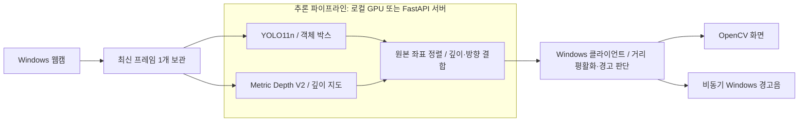

# Obstacle Vision

**웹캠 기반 실시간 객체 탐지 · 추정 거리 표시 · 중앙 장애물 경고**

YOLO11n과 Metric Depth Anything V2를 같은 프레임에 적용해 객체의 종류·방향·추정 깊이를 결합하는 컴퓨터 비전 프로젝트입니다. Windows 클라이언트에서 가까운 중앙 객체를 시각화하고, 거리 변동과 반복 알림을 제어하면서 경고음을 재생합니다.

구현 범위는 **모델 추론 통합, 객체별 깊이 결합, 실시간 영상 처리, 경고 정책과 테스트**입니다. 공식 사전 학습 모델을 사용하며 별도 모델 학습은 수행하지 않습니다.

## 프로젝트에서 다룬 문제

객체 탐지 결과에는 종류와 위치가 있지만, 카메라에서 얼마나 떨어져 있는지는 포함되지 않습니다. 이 프로젝트는 탐지 박스와 미터 단위 깊이 지도를 연결하고, 객체의 화면 내 방향과 거리를 함께 전달하는 것을 목표로 합니다.

실시간으로 사용하려면 모델 연결 외에도 처리해야 할 문제가 있습니다. 박스에 섞인 배경 깊이, 프레임마다 흔들리는 추정값, 느린 추론으로 누적되는 영상 지연, 반복 경고음과 통신 실패를 다룹니다.

## 주요 기능

| 기능 | 동작 |
| --- | --- |
| 탐지 대상 제한 | 설정한 COCO 10종만 YOLO `classes`에 전달하고, 실제 `model.names`와 ID·이름을 검증 |
| 객체별 추정 거리 | 원본 좌표에 정렬한 깊이 지도의 박스 중앙 영역에서 유효값 중앙값 계산 |
| 표시 거리 제한 | 평활화한 추정 거리가 3m 이하인 객체만 박스·이름·신뢰도·방향·`Est.` 거리 표시 |
| 중앙 객체 경고 | CENTER 또는 중앙 구역과 충분히 겹치는 객체 중 가장 가까운 유효 객체 선택 |
| 경고 안정화 | 객체별 거리 이력, 이동 중앙값, 연속 프레임 확인, 히스테리시스와 반복 간격 적용 |
| 실시간 화면 | 처리 완료 기준 FPS, 프레임 나이, 소리 ON/OFF, 경고 단계 표시 |
| 오류 대응 | 깊이 무효·통신 실패·오래된 프레임의 경고 중단, 최신 프레임 재시도 |
| 검증 자료 기록 | 처리 시간 CSV와 줄자 실측 비교 CSV 제공 |

기본 탐지 대상은 **사람, 자전거, 벤치, 개, 배낭, 여행가방, 의자, 소파, 화분, 식탁**입니다. 목록과 경고 조건은 [config/settings.toml](config/settings.toml)에서 바꿀 수 있습니다. 제외한 클래스와 모델이 인식하지 못한 위험 요소까지 탐지하는 기능은 아닙니다.

중앙 후보의 평활화된 거리에 적용하는 기본 기준은 다음과 같습니다. 실제 단계 전환에는 아래 설명한 확인 프레임과 히스테리시스가 적용됩니다.

| 추정 거리 | 단계 | 경고음 |
| --- | --- | --- |
| 2m 초과 | Normal | 없음 |
| 1m 초과~2m 이하 | Warning | 짧은 1회 음, 최소 3초 간격 |
| 1m 이하 | Danger | 높은 주파수의 2회 음, 최소 1.5초 간격 |

중앙 후보는 있지만 유효 거리가 없거나, 결과가 오래되거나 실패하면 `Unknown`으로 처리합니다. 초기 상태 확인 중에도 `Unknown`이 표시될 수 있습니다. 깊이를 알 수 없는 객체에 임의 값이나 이전 거리값을 채우지 않습니다.

## 아키텍처



그림은 데이터 흐름을 나타냅니다. 두 모델은 같은 프레임에 대해 순차 추론하며, 결과 결합 후 클라이언트가 경고 단계를 판단합니다.

| 실행 방식 | Windows가 담당하는 일 | 추론 위치 |
| --- | --- | --- |
| 로컬 | 웹캠·추론·화면·소리 전체 | Python `.venv`, CUDA GPU |
| Docker 구성 | 웹캠·거리 평활화·경고 판단·화면·소리 | 컨테이너의 FastAPI + CUDA GPU |

두 방식은 같은 [추론 파이프라인](app/pipeline.py)을 사용합니다. 원격 모드에서는 JPEG 프레임을 보내고 객체·거리·방향 JSON을 받습니다. 기본 통신 주소는 `127.0.0.1:8000`입니다.

Docker 구성은 Windows 호스트가 카메라·GUI·스피커를 담당하고 추론만 컨테이너로 분리한 구조입니다. **Dockerfile·Compose 설정은 작성했으며, 실제 컨테이너 빌드와 GPU 전달은 미검증입니다.** Windows에서 직접 실행한 동일 FastAPI 서버의 통신은 확인했습니다.

## 설계와 문제 해결

### 객체 박스와 깊이 지도의 좌표·단위 맞추기

YOLO 박스는 원본 프레임 좌표를 사용하고, 깊이 출력도 원본 높이·너비로 복원합니다. 두 해상도가 다르면 결합 단계에서 오류를 내어 잘못된 픽셀과 객체를 연결하지 않도록 했습니다.

깊이는 **공식 Metric Depth Anything V2 Small / Hypersim** 구현과 체크포인트를 사용합니다. 공식 출력은 미터 단위이며 모델 최대 깊이 설정은 20m입니다. 체크포인트는 고정 revision과 SHA256으로 검증합니다. [구현](app/depth_estimator.py) · [모델 출처](THIRD_PARTY.md)

### 배경 픽셀과 순간적인 거리 변화 줄이기

박스 전체에는 배경이 섞일 수 있어 중앙 가로·세로 50% 영역, 즉 박스 면적의 약 25%를 사용합니다. NaN·Inf·0·음수와 범위 밖 값을 제외하고, 기본 유효 깊이 0.05~20m의 픽셀이 영역의 20% 이상일 때 중앙값을 계산합니다. [구현](app/fusion.py)

클라이언트는 같은 클래스의 박스를 IoU로 연결해 최근 5개 거리의 이동 중앙값을 적용합니다. 탐지 순서가 달라져도 거리 이력을 분리하기 위한 간단한 연결 방식이며, 가림·교차 상황에서의 영구적인 객체 식별을 보장하지 않습니다. 의자 구멍 등으로 중앙 영역에 배경이 들어가는 문제도 남아 있습니다. [구현](app/alerts.py)

### 경고 단계의 흔들림과 반복 재생 억제

- Normal·Warning·Danger로 전환할 때는 새 추론 결과 2회 연속 확인 후 적용합니다. 무효·만료 결과의 `Unknown` 전환은 즉시 적용합니다.
- 단계가 낮아질 때 0.15m 히스테리시스를 적용합니다. 기본 Danger는 1.15m, Warning은 2.15m를 넘은 뒤 해제될 수 있습니다.
- Warning→Danger 상승이 확인되면 일반 반복 간격을 기다리지 않고 Danger 재생을 요청합니다.
- 박스 중심이 CENTER이거나, 중앙 1/3과 겹치는 가로 폭이 화면 경계로 자른 박스 폭의 35% 이상이면 중앙 후보로 봅니다.

평활화와 확인 프레임은 경고 흔들림을 줄이지만 반응을 늦출 수 있습니다. 경고 정책은 모델·카메라·사운드 없이 가상 거리와 시각으로 테스트할 수 있도록 분리했습니다. [정책 구현](app/alerts.py) · [정책 테스트](tests/test_alerts.py)

### 영상 지연과 소리 재생 분리

캡처는 최신 프레임 하나만 보관하고 추론도 한 번에 하나만 실행합니다. 처리하지 못한 과거 프레임을 계속 쌓지 않습니다. 화면에는 추론에 사용한 프레임과 그 결과를 함께 표시합니다. [카메라](app/camera.py) · [클라이언트](app/main.py)

경고음은 별도 worker에서 `winsound.Beep`로 재생합니다. 대기 항목은 최대 하나이고 Danger를 우선 처리합니다. 재생 실패가 영상 루프를 중단하지 않도록 예외를 처리합니다. 통신 실패 또는 기본 1초의 프레임 유효 시간 초과 시 이전 경고와 대기 소리를 취소합니다. [사운드 구현](app/sound.py) · [통합 테스트](tests/test_alert_client.py)

## 검증 결과

검증일 **2026-10-16**, Windows 11 / Python 3.11.15 / RTX 3080 10GB / PyTorch 2.6.0+cu124 환경에서 수행한 검증 기록입니다.

| 검증 | 결과와 범위 |
| --- | --- |
| 자동 테스트 | 하드웨어 검사를 활성화한 전체 실행 **211 passed**. 기본 실행에서는 실제 CUDA·웹캠 검사 2건 제외 |
| 코드·의존성 검사 | Ruff, compileall, pip check 통과 |
| 실제 GPU 추론 | YOLO·Metric Depth 모두 `cuda:0` 배치와 실제 텐서 연산 확인 |
| 클래스 필터 | 공개 실내 이미지에서 소파만 반환하고 고양이·리모컨 제외 |
| 클라이언트 경고 판단 | 공개 정지 이미지의 약 1.63m 중앙 소파가 `Unknown → Warning`으로 전환 |
| 웹캠·API·화면 | 로컬 실행과 Windows localhost FastAPI + 경량 클라이언트 실행 확인 |

경고 정책 테스트는 거리 경계, 가장 가까운 중앙 객체, 박스 순서 변경, 반복 간격, 단계 상승, M 토글, 비동기 재생, 잘못된 깊이값을 확인합니다. 통합 테스트에서는 **통신 실패 7회 후 복구**와 다음 추론이 멈춘 동안의 오래된 프레임 만료도 검사했습니다.

### 측정 조건별 처리 시간

공통 입력은 640×480, YOLO 크기 640 / Depth 기준 크기 518입니다. FPS는 새로 완료한 결과를 기준으로 계산합니다.

| 측정 | 표본·조건 | 관측값 |
| --- | --- | --- |
| 정지 이미지 전체 GPU 추론 | 공개 실내 이미지, 워밍업 3회 후 10회. 캡처·HTTP·화면 제외 | 평균 **69.42ms** |
| 로컬 웹캠 | 30개 결과, headless·mute | 최근 완료 **13.75 FPS** |
| localhost API 웹캠 | 10개 결과, 경량 클라이언트 GUI·mute | 최근 완료 **12.00 FPS** |

두 웹캠 측정 장면에서는 허용 객체가 탐지되지 않았습니다. 따라서 영상·통신 처리 실행을 확인한 수치이며, 실제 근접 장애물 경고의 성능 근거로 사용하지 않습니다. 짧은 별도 실행이므로 모드별 성능 우열이나 목표 FPS를 보장하지 않습니다.

원시 JSON·CSV와 실행 명령은 [객체 필터·경고 검증 기록](docs/ALERT_VALIDATION.md), 변경 전 기록은 [기존 검증 기록](docs/VALIDATION.md)에 있습니다.

## 빠른 실행

Windows PowerShell에서 프로젝트 루트를 기준으로 실행합니다. Docker·Conda는 로컬 실행에 필수가 아닙니다. VS Code 터미널이나 별도 PowerShell에서 같은 명령을 사용할 수 있습니다.

```powershell
py -3.11 -m venv .venv
.\.venv\Scripts\python.exe -m pip install --upgrade pip
.\.venv\Scripts\python.exe -m pip install torch==2.6.0 torchvision==0.21.0 --index-url https://download.pytorch.org/whl/cu124
.\.venv\Scripts\python.exe -m pip install -r requirements.txt
.\.venv\Scripts\python.exe -m tools.diagnose --require-cuda
.\.venv\Scripts\python.exe -m app.main --mode local --camera 0
```

모델은 첫 실행 시 공식 출처에서 다운로드하고 `models/`에 캐시합니다. Python 3.11·가상환경·가중치가 이미 준비돼 있다면 마지막 실행 명령만 사용하면 됩니다. 다른 PC에서는 가상환경을 새로 만듭니다.

| 조작 | 동작 |
| --- | --- |
| Q | 종료 |
| M | 소리 ON/OFF |
| S | 거리 검증 옵션 사용 시 선택 객체의 추정값 CSV 기록 |

키는 OpenCV 영상 창에 포커스를 준 뒤 누릅니다. 소리 없이 시작하려면 `--mute`, 설정을 선택하려면 `--config .\config\settings.toml`을 추가합니다.

설치·GPU 진단·Docker 실행·설정·CSV·문제 해결은 [설치·사용 가이드](docs/INSTALL.md)에 정리했습니다.

### 테스트 실행

```powershell
.\.venv\Scripts\python.exe -m pip install -r requirements-dev.txt
.\.venv\Scripts\python.exe -m pytest -q
```

일반 테스트는 가짜 모델·카메라·네트워크·소리를 사용합니다. 실제 장비 검사는 `RUN_HARDWARE_TESTS=1`로 선택합니다. [상세 검증 명령](docs/ALERT_VALIDATION.md)

## 기술과 코드 구성

| 영역 | 기술 |
| --- | --- |
| 객체 탐지 | Ultralytics 8.3.221, YOLO11n / COCO |
| 깊이 추정 | 공식 Metric Depth Anything V2 Small / Hypersim, PyTorch·CUDA |
| 영상·수치 처리 | OpenCV, NumPy |
| 추론 API | FastAPI, Requests, JPEG/JSON |
| 경고·설정·검증 | winsound·threading, TOML, pytest·Ruff |
| 선택적 배포 구성 | Docker Desktop, WSL2, Docker Compose |

```text
Obstacle_Detection/
├── app/                 # 모델 어댑터, 결합, 카메라, 경고 정책, 화면·소리
├── server/api.py        # 단일 동시 추론 슬롯을 사용하는 FastAPI
├── config/settings.toml # 탐지 클래스·표시 거리·경고 조건
├── tools/              # 다운로드, 진단, 모델·사운드 검사
├── tests/              # 단위·통합·선택적 하드웨어 테스트
├── third_party/        # 고정 커밋의 공식 Metric Depth 소스·라이선스
├── docs/               # 설치 가이드, 검증 기록, 원시 측정 자료
├── models/             # 가중치 캐시, Git 제외
├── outputs/            # 실행 결과·측정 CSV, Git 제외
├── Dockerfile
└── compose.yaml
```

## 한계와 다음 검증

- **거리의 의미:** 출력은 광축 방향의 추정 깊이입니다. 카메라에서 객체까지의 직선 거리나 가장 가까운 표면 거리와 다를 수 있습니다. 줄자 기준 절대 정확도는 미검증입니다.
- **탐지·연결의 한계:** 10종 필터로 벽·계단·턱 등의 탐지를 보장하지 않습니다. 배경 혼입, 반사·투명 물체, 가림과 교차 시 깊이나 IoU 연결이 잘못될 수 있습니다.
- **실제 경고 검증:** Windows 소리 재생 요청은 실행했지만 스피커 청취, 실제 장애물에 접근하며 수행하는 Warning/Danger 전환은 미검증입니다. Q/M은 가짜 GUI 입력으로 테스트했습니다.
- **Docker:** 설정과 YAML 정적 검사는 완료했으며 컨테이너 빌드·실행·GPU 전달은 미검증입니다.

다음 검증은 거리·조명·화면 위치별 줄자 비교 CSV 수집, 실제 스피커·경고 전환 확인, Docker 환경 실행입니다. `Normal`과 무음은 주변 공간의 안전을 뜻하지 않습니다.

## 관련 문서와 출처

- [설치·실행·설정·문제 해결](docs/INSTALL.md)
- [객체 필터·경고 기능 검증과 원시 자료](docs/ALERT_VALIDATION.md)
- [초기 모델·웹캠 검증 기록](docs/VALIDATION.md)
- [모델·소스 커밋·체크포인트 해시·라이선스](THIRD_PARTY.md)
- [Ultralytics YOLO11](https://docs.ultralytics.com/models/yolo11/) · [공식 Metric Depth 구현](https://github.com/DepthAnything/Depth-Anything-V2/tree/main/metric_depth)

공식 모델·소스의 라이선스와 이미지 출처를 확인한 뒤 재배포해야 합니다. 모델 가중치는 저장소에 포함하지 않습니다.
